## Diversidade funcional e serviços ecossistêmicos

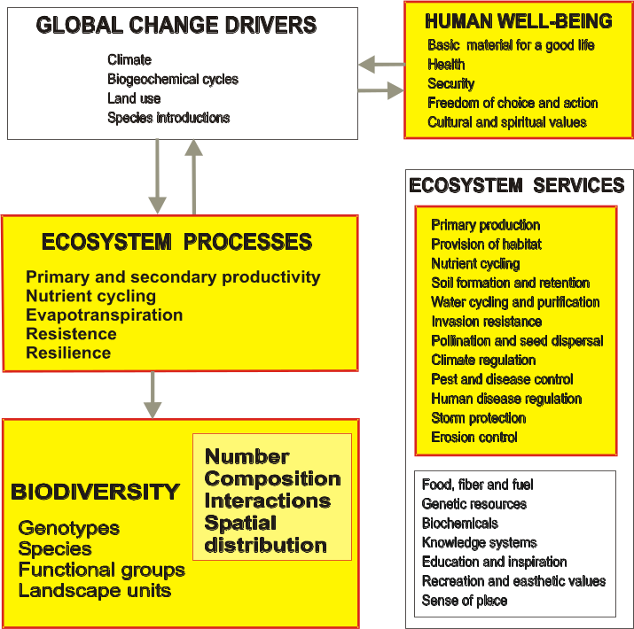{fig-align="center" width="55%"}

::: ref
Millennium Ecosystem Assessment (2005)
:::

## Biodiversidade e Funcionamento do Ecossistema (BFE) {.smaller}

O que vamos fazer?

1. BFE: riqueza de espécies e diversidade funcional
2. Como isso funciona? Uma abordagem em etapas
3. BFE: desvendando os mecanismos
4. BFE: o papel da dominância

# 1. BFE: riqueza de espécies

## Evidência experimental do efeito da biodiversidade sobre os processos ecossistêmicos

:::: {.columns}
::: {.column width="55%"}
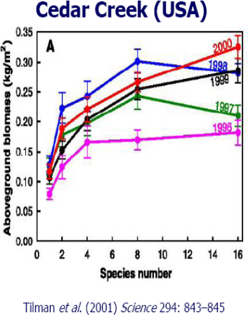{fig-align="center"}
:::
::: {.column width="45%"}
- Mais espécies → maior produtividade (complementaridade de nicho)
- Poucas espécies são necessárias para manter a produtividade (10?)
- E como isso funciona em florestas tropicais ricas em espécies? (TftT!!)
:::
::::

::: ref
Tilman et al. (2001) Science
:::

## Existe relação entre biodiversidade e biomassa?

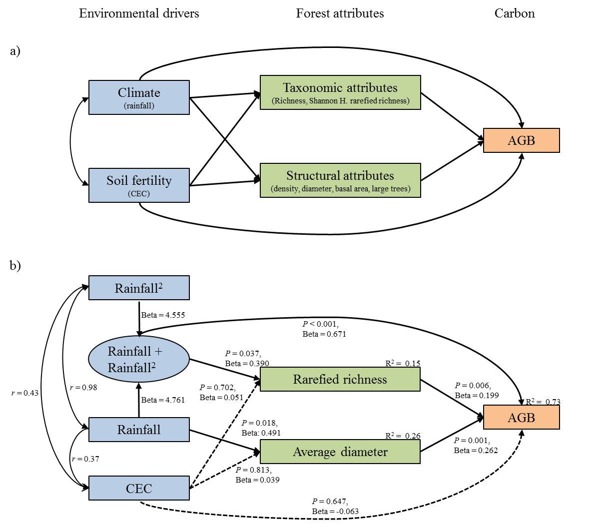{fig-align="center" width="45%"}

*Eixo x: riqueza rarefeita (nº de espécies / 85 troncos); eixo y: biomassa aérea (Mg/ha).*

::: ref
Poorter, van der Sande, Peña-Claros, Arets, Costa, Carvalho, de Castilho, Junqueira, Levis, Schietti, Souza, Stropp e 60 amigos (no prelo) GEB
:::

# 1. BFE: diversidade funcional

## A riqueza de espécies é importante?

:::: {.columns}
::: {.column width="45%"}
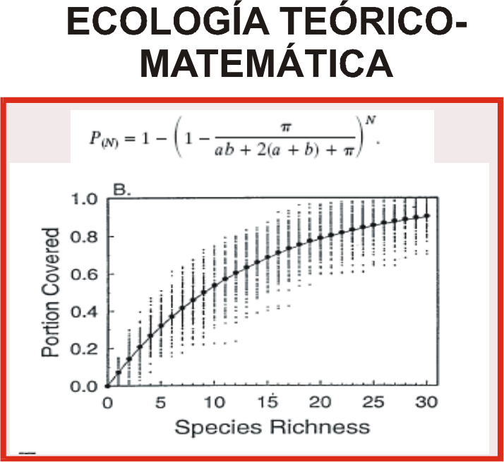{fig-align="center"}

*Processo ecossistêmico × riqueza de espécies*
:::
::: {.column width="55%"}
- Nem todas as espécies são iguais
- Nem todas as espécies são igualmente abundantes na natureza
- **O que importa não é o número de espécies, mas seus atributos funcionais**
:::
::::

::: ref
Slide: S. Díaz
:::

::: {.notes}
Combinar distribuição, diversidade e atributos funcionais para resolver problemas práticos, usando um arcabouço teórico sólido.
:::

## O que é biodiversidade funcional?

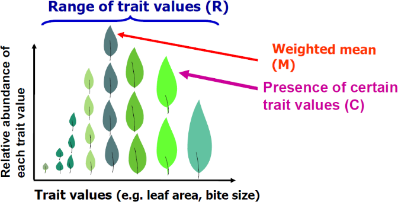{fig-align="center" width="70%"}

**Biodiversidade funcional** = a média, a amplitude e o valor dos atributos funcionais em uma dada comunidade ecológica.

*Figura: amplitude dos valores do atributo (R), média ponderada (M) e presença de certos valores (C).*

::: ref
Slide: S. Díaz
:::

## Quais atributos medir? Depende da pergunta!

Atributos diferentes influenciam processos e serviços ecossistêmicos diferentes.

| Atributos das plantas | Processos ecossistêmicos | Serviços ecossistêmicos |
|---|---|---|
| Taxa relativa de crescimento; tamanho; teor de nutrientes | Produtividade primária | Alimento, fibras e combustível; sequestro de carbono; estabilidade do solo; regulação de gases |
| Taxa relativa de crescimento; teor de nutrientes; palatabilidade | Produtividade secundária | Produção de alimento e fibras; conservação da vida silvestre |
| Teor de nutrientes | Ciclagem de nutrientes | Fertilidade do solo; tratamento de resíduos na água |
| Lenhosidade; arquitetura do dossel; longevidade foliar | Complexidade estrutural | Conservação da vida silvestre; amortecimento climático; valores culturais |
| Arquitetura radicular; arquitetura do dossel; longevidade foliar | Dinâmica da água | Suprimento de água; amortecimento climático e de enchentes; controle da erosão; proteção da fertilidade do solo |

::: ref
Díaz et al. (2007) GCTE Synthesis Book
:::

## Os serviços ecossistêmicos dependem dos atributos das espécies **dominantes**

Díaz et al. (2006) PLOS Biology

| Serviços ecossistêmicos de suporte/regulação | Média ponderada | Amplitude |
|---|:---:|:---:|
| Produção de biomassa | ●●● | ● |
| Preservação da fertilidade do solo | ●●● |  |
| Polinização de plantas importantes | ●●● | ● |
| Provisão de habitat para animais importantes | ●●● | ● |
| Resistência a invasões | ●●● | ● |
| Regulação da qualidade e da quantidade de água | ●●● |  |
| Controle agrícola de pragas | ● | ●●● |
| Regulação climática (retroalimentações biofísicas) | ●●● |  |
| Regulação climática (sequestro de carbono) | ●●● | ● |
| Proteção contra riscos naturais | ●●● |  |

## Os serviços ecossistêmicos dependem dos atributos das espécies **dominantes**

:::: {.columns}
::: {.column width="30%"}
Geovana Carreño et al. (2012) Journal of Ecology

**Como a MPC muda após a exploração madeireira? Os serviços são mantidos?**

- Mais perturbação → espécies com atributos pioneiros ficam mais abundantes
- A densidade da madeira diminui → menor retenção de carbono a longo prazo
- Nitrogênio e AFE aumentam → mais ciclagem de nutrientes
- A diversidade funcional não muda → tamponada contra mudanças ambientais
:::
::: {.column width="70%"}
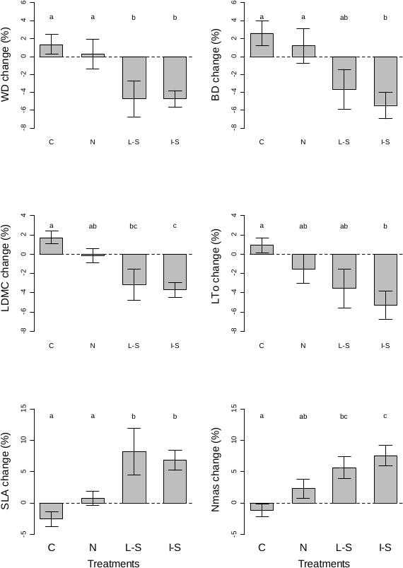{fig-align="center" width="48%"}

*Mudança (%) na densidade da madeira, na área foliar específica (AFE) e no teor de nitrogênio foliar ao longo da intensidade de exploração (baixa → alta).*
:::
::::

## Os SE dependem da amplitude dos valores dos atributos

:::: {.columns}
::: {.column width="50%"}
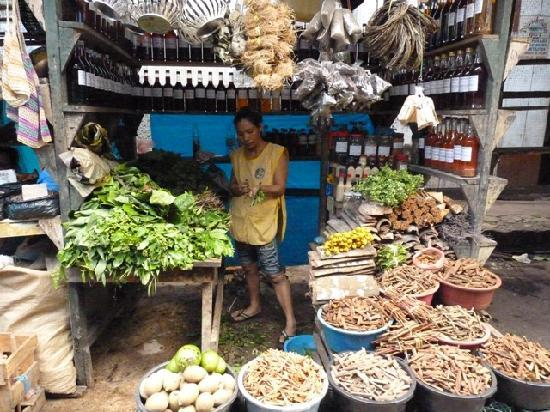{width="48%"} 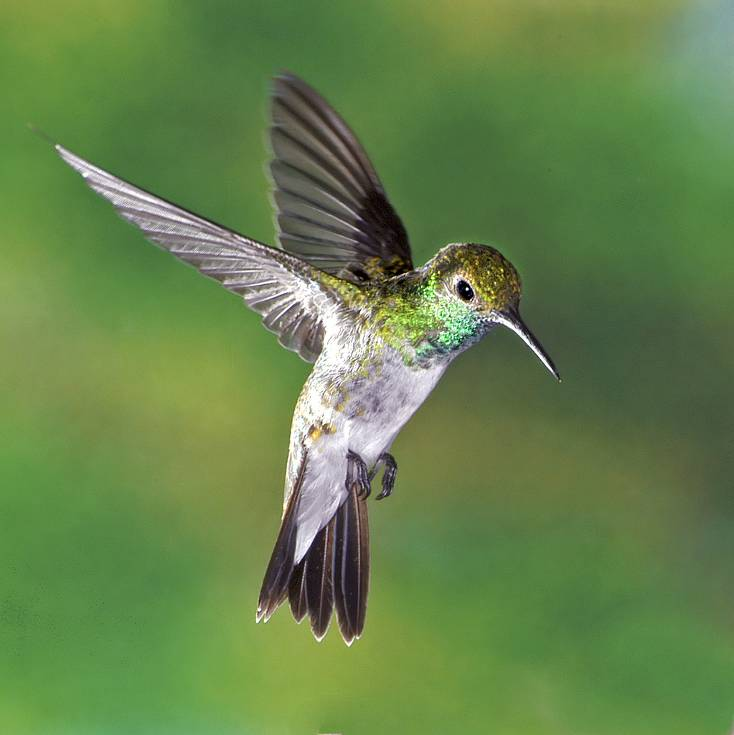{width="48%"}
:::
::: {.column width="50%"}
- Segurança alimentar na agricultura de subsistência
- Segurança de recursos para os povos da floresta
- Fruição estética, turismo baseado na natureza
- Produtividade do ecossistema
- Amortecimento do ecossistema frente a mudanças ambientais
:::
::::

## Os SE dependem da presença de certos valores de atributos/espécies

:::: {.columns}
::: {.column width="50%"}
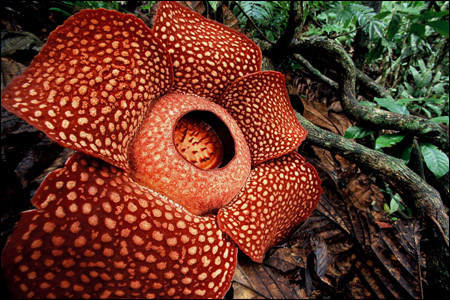{width="48%"} 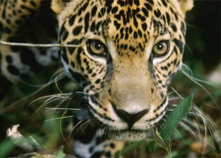{width="48%"}
:::
::: {.column width="50%"}
- Turismo baseado na natureza
- Grandes predadores e estrutura trófica
- Árvores sagradas
:::
::::

## Resumo 1: Biodiversidade e Funcionamento do Ecossistema

**BFE: riqueza de espécies e diversidade funcional**

- A biodiversidade é importante para os SE
- Biodiversidade funcional: média, amplitude (distribuição) e valor dos atributos na comunidade
- Diferentes aspectos da diversidade são importantes para diferentes processos e serviços

*A seguir: 2. Como isso funciona? Uma abordagem em etapas · 3. BFE: desvendando os mecanismos · 4. BFE: o papel da dominância*

# 2. Abordagem em etapas

## Como isso funciona? Uma abordagem em 5 etapas

1. Defina **qual processo ecossistêmico (PE)** e qual serviço ecossistêmico (SE) lhe interessam
2. Defina **quais atributos de efeito** devem afetar esses PE e SE
3. **Meça** esses **atributos** para: cada indivíduo? Cada espécie?
4. **Calcule** a composição funcional (**MPC**, média ponderada da comunidade) e/ou a diversidade funcional (**DF**) usando duas matrizes (parcelas × espécies, espécies × atributos)
5. **Relacione** os atributos funcionais da parcela ao PE usando uma abordagem passo a passo (por exemplo, um modelo de equações estruturais)

## Etapa 2: Quais atributos de efeito são relevantes?

| Atributo funcional | Resposta ao ambiente | Efeito sobre o funcionamento |
|---|---|---|
| Área foliar | Luz, calor | Produtividade |
| Área foliar específica | Luz, calor | Produtividade |
| Comprimento do pecíolo | Luz | Produtividade |
| Teor de nitrogênio | Luz | Produtividade, decomposição |
| Teor de fósforo | Luz | Produtividade, decomposição |
| Rendimento quântico | Luz | Produtividade |
| Espessura foliar | Sombra, herbivoria | Estoques de carbono, produção de serapilheira |
| Teor de matéria seca foliar | Sombra, herbivoria | Estoques de carbono, produção de serapilheira |
| Dureza foliar | Sombra, herbivoria | Estoques de carbono, produção de serapilheira |
| Fluorescência | Sombra | Produtividade |
| Teor de clorofila | Sombra | Produtividade |
| Volume da semente | Sombra | Fonte de alimento |
| Densidade da madeira | Sombra, seca | Estoques de carbono |
| Composição foliar (folhas compostas) | Seca, calor | Produtividade |
| Deciduidade | Seca, calor | Produção de serapilheira |
| Dispersão biótica | Paisagens mais conectadas | Fonte de alimento |

## Etapa 3: Desenho amostral para medir atributos

:::: {.columns}
::: {.column width="55%"}
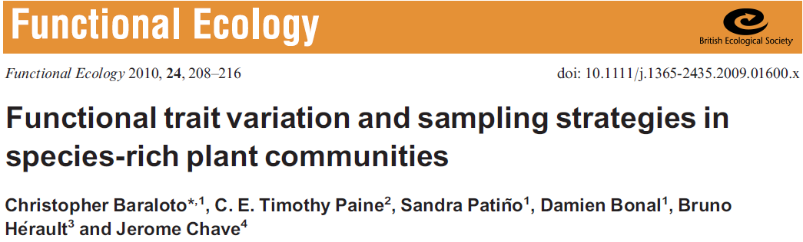{fig-align="center"}
:::
::: {.column width="45%"}
**Objetivo:** ligar as características funcionais da parcela ao PE.

Cinco estratégias de amostragem:

1. Todos os indivíduos de uma parcela
2. Indivíduos aleatórios de uma parcela
3. Um indivíduo por espécie por parcela
4. Todas as espécies (abordagem de banco de dados), com medição possível fora da parcela
5. As espécies dominantes (>80% da cobertura ou da AB), com medição possível fora da parcela (abordagem de banco de dados)

*Do difícil e preciso (lento e suado) ao simples e rápido.*
:::
::::

::: ref
Baraloto et al. (2010) Functional Ecology
:::

## Com que frequência a estimativa da parcela fica a 5% do valor real?

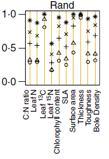{fig-align="center" width="30%"}

*Painéis: MPC da parcela e variação dos atributos na parcela, por estratégia (aleatório, um indivíduo por espécie, banco de dados).*

- É mais fácil medir a MPC do que medir a variação dos atributos
- Um indivíduo por espécie por parcela é relativamente bom; o banco de dados é mais ou menos

## Estimando a MPC: abordagem simples ou difícil?

:::: {.columns}
::: {.column width="55%"}
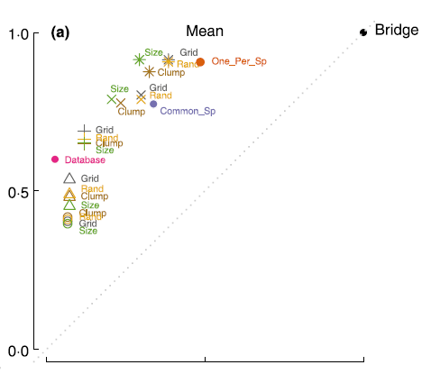{fig-align="center"}
:::
::: {.column width="45%"}
*Eixo x: custo relativo; eixo y: acurácia relativa.*

- Compromisso (*trade-off*) entre acurácia e custo (dinheiro, tempo)
- Escolha o seu ponto favorito na curva de compromisso!
:::
::::

## Etapa 4: Dos atributos das espécies aos atributos da comunidade vegetal

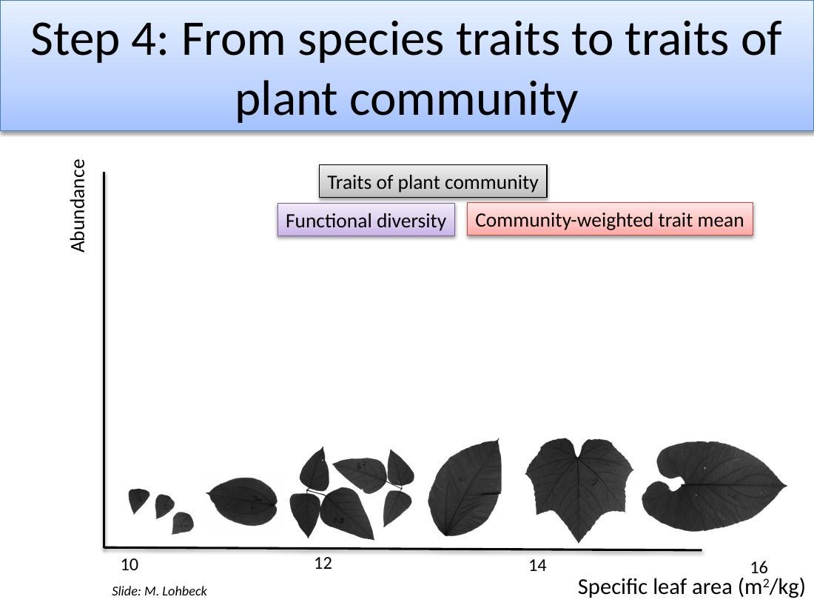{fig-align="center" width="70%"}

*Variáveis: abundância; média ponderada da comunidade (MPC); diversidade funcional (DF). Eixo x: área foliar específica (m²/kg).*

::: ref
Slide: M. Lohbeck
:::

## Dos atributos das espécies aos atributos da comunidade vegetal

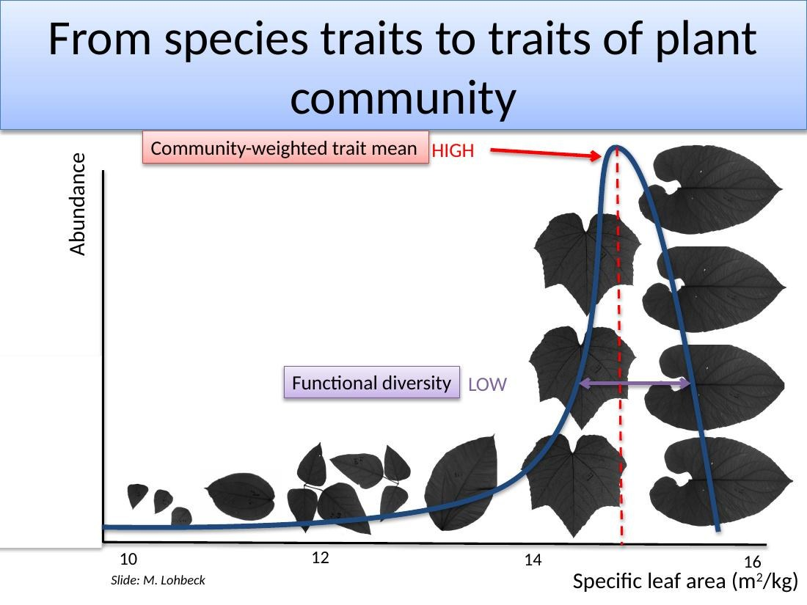{fig-align="center" width="70%"}

*Aqui: MPC **alta** e diversidade funcional **baixa**.*

::: ref
Slide: M. Lohbeck
:::

## Dos atributos das espécies aos atributos da comunidade vegetal

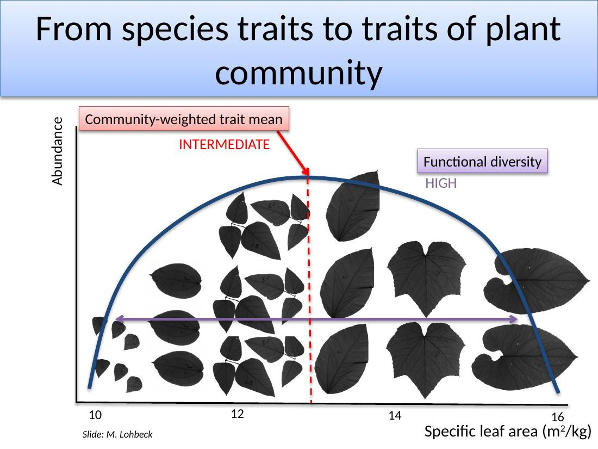{fig-align="center" width="70%"}

*Aqui: MPC **intermediária** e diversidade funcional **alta**.*

::: ref
Slide: M. Lohbeck
:::

## Ponderar os atributos das espécies por quê?

- **Presença/ausência:** espécies acidentais têm grande influência sobre a MPC → fracamente relacionada ao PE
- **Abundância:** mais interessante se o foco for a montagem da comunidade → moderadamente relacionada ao PE
- **Área basal (ou cobertura):** acompanha de perto a biomassa e a área foliar total → mais fortemente relacionada ao PE

## Etapa 4: Quais índices de diversidade funcional usar?

:::: {.columns}
::: {.column width="45%"}
**Riqueza funcional (Friq):** a quantidade de espaço funcional ocupada por um conjunto de espécies

**Equabilidade funcional (Feqü):** a regularidade da distribuição das abundâncias das espécies nesse espaço

**Divergência funcional (Fdiv):** a proporção da abundância total sustentada pelas espécies com os valores de atributos mais extremos dentro de uma comunidade
:::
::: {.column width="55%"}
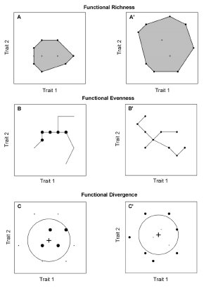{fig-align="center" width="55%"}

*Baixa (esquerda) e alta (direita).*
:::
::::

> "Friq, Fdiv e Feqü soam como nomes dos integrantes de uma banda de techno ruim..."

::: ref
Mouillot et al. (2011) PLOS ONE · Slide: S. Díaz
:::

## Ressalvas sobre os índices de diversidade funcional

Os processos ecossistêmicos são determinados pela variação em:

- todos os atributos? → o índice de DF fornece um resumo poderoso
- um subconjunto de atributos?
- um único atributo? → o índice de DF esconde o padrão

**VMV: Vago MultiVariado; você não sabe o que está olhando!**

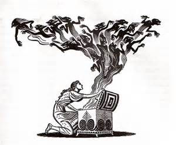{.absolute right=0 bottom=0 width="14%"}

::: {.notes}
Na mitologia grega, Pandora (do grego Πανδώρα, de πᾶν, *pān*, "tudo", e δῶρον, *dōron*, "dádiva", portanto "a toda dotada", "a toda presenteada" ou "a que tudo oferece") foi a primeira mulher humana criada pelos deuses, especificamente por Hefesto e Atena, por ordem de Zeus. Segundo Hesíodo, cada deus ajudou a criá-la dando-lhe dons únicos. Zeus ordenou que Hefesto a moldasse em terra, como parte do castigo da humanidade pelo roubo do segredo do fogo por Prometeu, e todos os deuses lhe ofereceram "dádivas sedutoras". Seu outro nome, Anesídora ("a que envia dádivas de baixo"), está inscrito junto à sua figura em uma kylix de fundo branco no Museu Britânico.

Segundo o mito, Pandora abriu uma jarra (*píthos*), às vezes traduzida erroneamente como "caixa de Pandora", libertando todos os males da humanidade (exceto a Esperança, que permaneceu dentro quando ela a fechou). Ela abriu a jarra por simples curiosidade, não por malícia.

Hoje, a expressão "abrir a caixa de Pandora" significa realizar uma ação que parece pequena ou inocente, mas que acaba tendo consequências graves e de longo alcance.
:::

## Uma alternativa ao VMV

Por que não simplesmente descrever a distribuição de cada atributo pela MPC, pelo coeficiente de variação (CV) e pela curtose (achatamento/pico, K)?

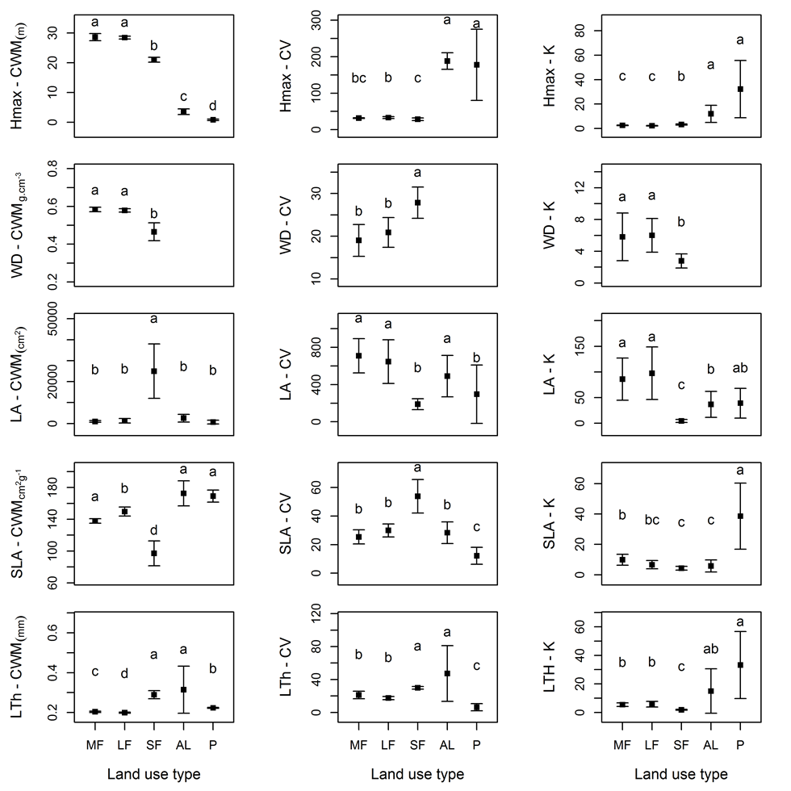{fig-align="center" width="75%"}

*Tipos de uso da terra: floresta madura, explorada, secundária, pastagem e área agrícola.*

::: ref
Carreño-Rocabado, Peña-Claros, Poorter et al. (2015) Ecological Applications
:::

## Etapa 5: encontrar o melhor modelo preditivo

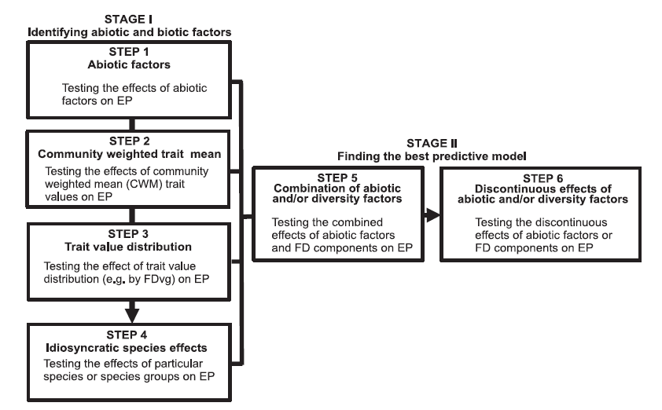{fig-align="center" width="70%"}

::: ref
Díaz et al. (2007) PNAS
:::

## Resumo 2: abordagem em cinco etapas

1. **Defina o processo ecossistêmico (PE)**
2. **Defina quais atributos de efeito** — crucial! Exige compreensão mecanística
3. **Meça** esses atributos para: cada indivíduo? Cada espécie?
   - a abordagem de banco de dados descreve bem a MPC, mas a variação, mal
   - medir por parcela um indivíduo por espécie?
4. **Calcule a MPC e a diversidade funcional (DF)**
   - ponderar pela AB tem relação mais estreita com o PE
   - a DF às vezes é vaga; o CV e a curtose (K) univariados são boas alternativas
5. **Relacione** os atributos funcionais da parcela ao PE

# 3. BFE: mecanismos

## Biodiversidade e Funcionamento do Ecossistema

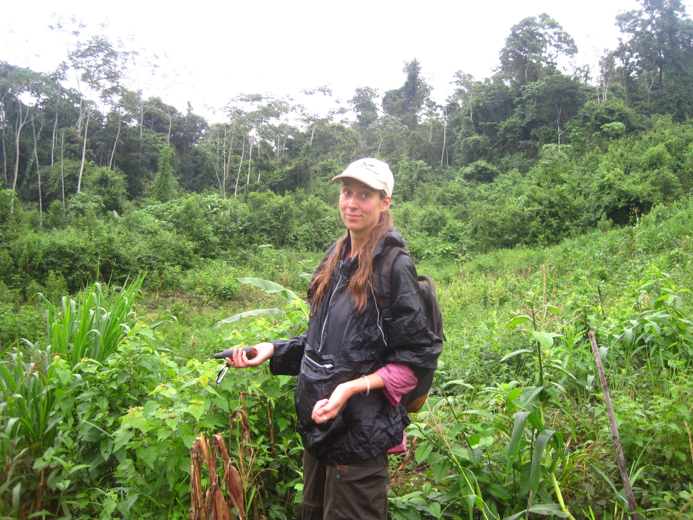{fig-align="center" width="45%"}

- Florestas tropicais: pontos quentes de diversidade e de carbono
- Armazenam 25% do carbono terrestre e respondem por 35% da PPL
- Qual é o papel da biodiversidade no armazenamento e no sequestro de carbono?
- Dois exemplos: floresta madura e floresta secundária

## Qual é o efeito da composição funcional sobre a produtividade florestal *entre* florestas?

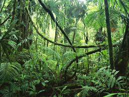{width="30%"} 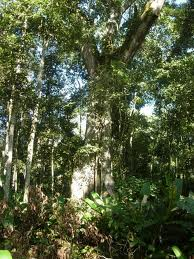{width="22%"} 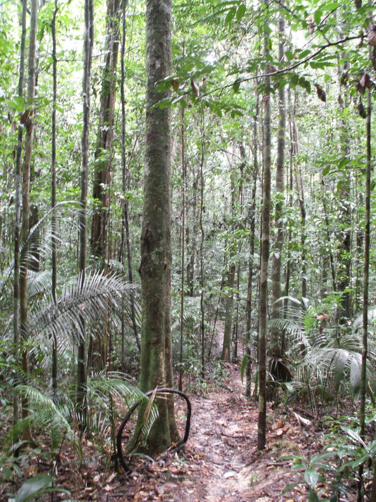{width="22%"}

*Sítios: Bolívia, Brasil e Costa Rica.*

Finegan, Peña-Claros, Díaz, Oliveira, Lorenzo, Vaz, Poorter et al. (2015) Journal of Ecology

## Os sítios diferem em atributos multivariados?

:::: {.columns}
::: {.column width="60%"}
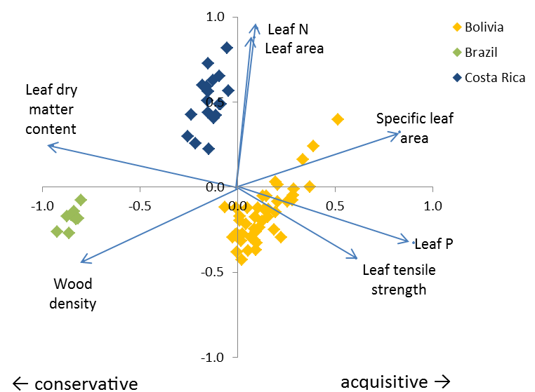{fig-align="center"}
:::
::: {.column width="40%"}
- Eixo de compromisso entre povoamentos conservativos e aquisitivos
- Separação clara dos sítios em suas propriedades funcionais comunitárias
:::
::::

::: {.notes}
ACP sobre a MPC de 8 atributos, antes da exploração madeireira. Hmax não foi incluída porque não estava disponível para a Costa Rica.

É estranho que a resistência à tração foliar esteja associada ao P e não ao teor de matéria seca foliar. Alguma ideia do motivo? Muito provavelmente as diferenças entre países determinam o padrão.
:::

## Qual é a relação entre atributos do povoamento, produtividade e estoques?

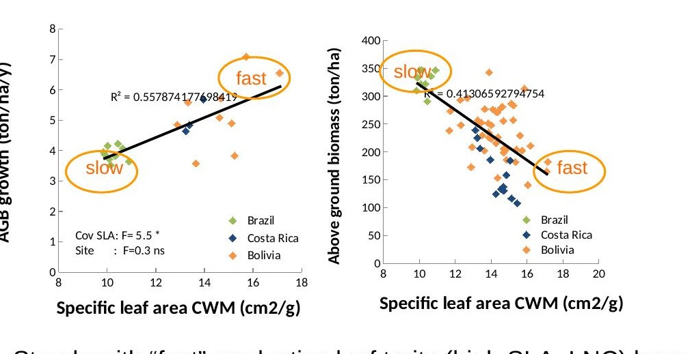{fig-align="center" width="75%"}

Povoamentos com atributos foliares produtivos "rápidos" (AFE e TNF altos) têm crescimento rápido da biomassa, mas rotatividade rápida → baixos estoques de biomassa.

*Crescimento da BAS (ton/ha/ano) e biomassa aérea (ton/ha) em função da MPC da AFE (cm²/g); lento → rápido.*

::: ref
Finegan, Peña-Claros, Díaz, Oliveira, Lorenzo, Vaz, Poorter et al. (2015) Journal of Ecology
:::

## A biodiversidade importa para a recuperação dos serviços ecossistêmicos durante a sucessão secundária?

{fig-align="center" width="40%"}

*Cronosequência: campo de milho → floresta de 2 anos → floresta de 14 anos.*

E um esquema conceitual?

::: {.notes}
Todos sabem o que é uma cronosequência? Aqui está a resposta... Substituição do espaço pelo tempo. Assumimos que sítios de idades diferentes se sucedem. Então este campo de milho, daqui a 2 anos, vai se parecer com este aqui...
:::

## Recuperação: 3 mecanismos hipotéticos

```{mermaid}
flowchart TD
  idade[idade] --> biomassa[biomassa]
  biomassa -->|"Sopa verde:<br/>mais biomassa →<br/>mais produtividade"| funcao[Função do ecossistema]
  biomassa --> df[Diversidade funcional]
  biomassa --> mpc[Média ponderada<br/>da comunidade]
  df -->|"Complementaridade de nicho:<br/>mais diversidade →<br/>mais produtividade"| funcao
  mpc -->|"Razão de massa:<br/>atributos aquisitivos →<br/>mais produtividade"| funcao
```

::: ref
Lohbeck, Poorter, Martinez-Ramos, Bongers (no prelo) Ecology
:::

## Qual mecanismo explica a recuperação da produtividade durante a sucessão secundária?

:::: {.columns}
::: {.column width="45%"}
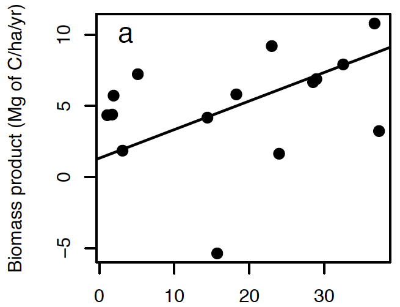{fig-align="center"}

*Produção de biomassa (Mg C/ha/ano) × biomassa (Mg C/ha).*
:::
::: {.column width="55%"}
Modelo hipotético e modelo observado: idade, biomassa, F-divergência e MPC da AFE → produtividade de biomassa (R² = 0,25).

- Hipótese da sopa verde confirmada!
- O forte gradiente de biomassa durante a sucessão ofusca o resto
- A quantidade de vegetação é mais importante que a qualidade da vegetação
:::
::::

::: ref
Lohbeck, Poorter, Martinez-Ramos, Bongers (no prelo) Ecology
:::

## O que determina o crescimento da biomassa em florestas maduras?

```{mermaid}
flowchart TD
  rec["Recrutamento:<br/>crescimento de biomassa<br/>dos recrutas"] --> liq
  cres["Crescimento:<br/>crescimento de biomassa<br/>dos sobreviventes"] --> liq
  mort["Mortalidade:<br/>perda de biomassa<br/>por mortalidade"] --> liq
  liq[Variação líquida de biomassa]
```

**O que impulsiona esses processos?**

::: ref
Masha vd Sande, Peña-Claros, Arets, Ascarunz, Toledo, Poorter et al. (submetido)
:::

::: {.notes}
No restante da apresentação vou falar apenas de recrutamento, crescimento e mortalidade.
:::

## Métodos: modelagem de equações estruturais (MEE)

:::: {.columns}
::: {.column width="33%"}
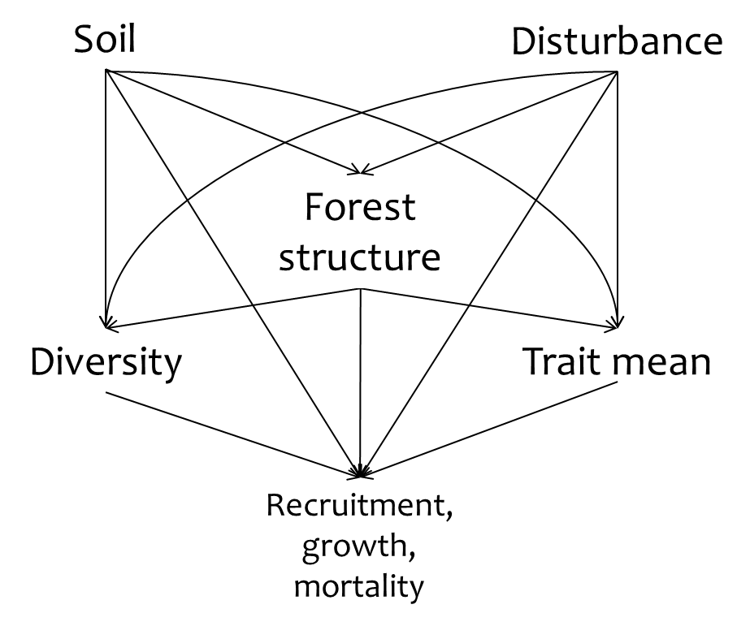

Recrutamento
:::
::: {.column width="33%"}
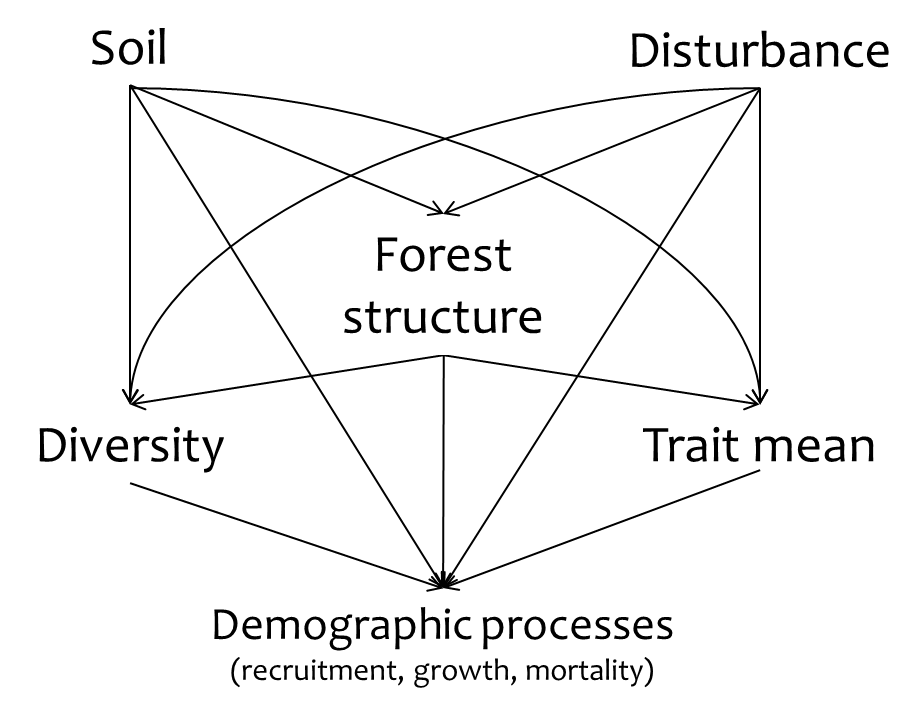

Crescimento
:::
::: {.column width="33%"}
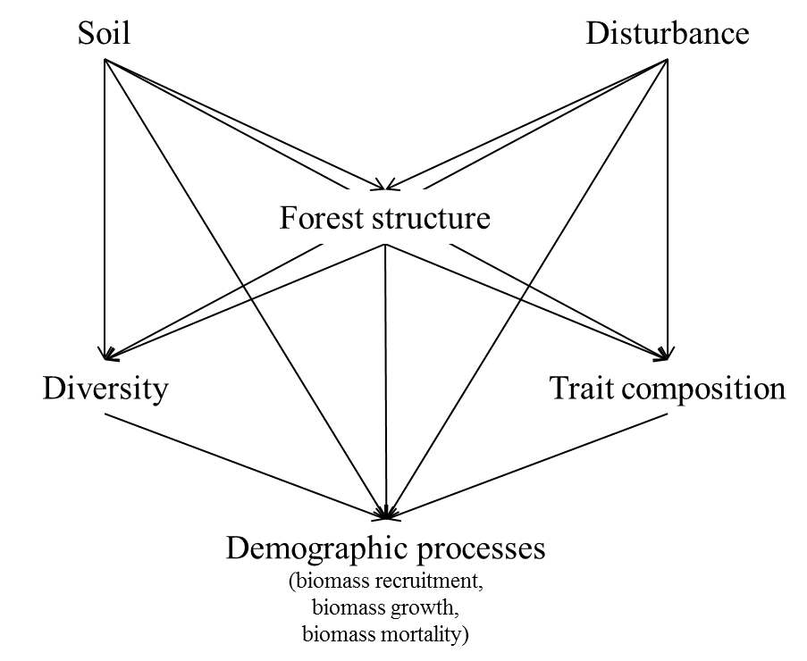

Mortalidade
:::
::::

→ Regressão linear múltipla → variação líquida de biomassa

A MEE permite separar os efeitos ambientais dos efeitos dos atributos!

::: ref
Masha vd Sande, Peña-Claros, Arets, Ascarunz, Toledo, Poorter et al. (submetido)
:::

## Resultados da MEE para as florestas maduras

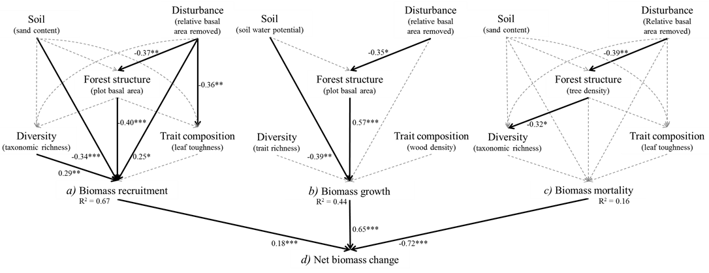{fig-align="center" width="90%"}

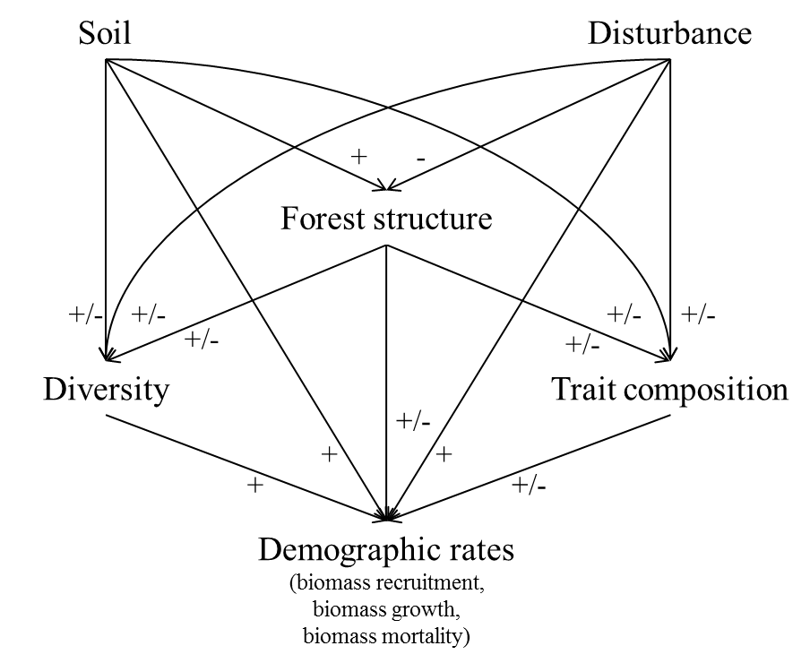{.absolute right=0 bottom=40 width="22%"}

- A quantidade de vegetação (sopa verde!) é importante
- A diversidade taxonômica favorece o recrutamento de biomassa
- Quem se importa com a composição funcional (MPC)?

::: ref
Masha vd Sande, Peña-Claros, Arets, Ascarunz, Toledo, Poorter et al. (submetido)
:::

## O que explica a dinâmica da biomassa em uma floresta seca brasileira?

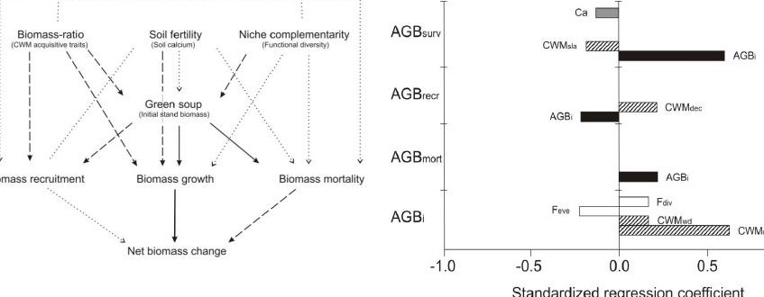{fig-align="center" width="70%"}

- A quantidade de vegetação (sopa verde!) é mais importante que a qualidade da vegetação
- A composição funcional (MPC) é mais importante que a diversidade funcional
- Atributos conservativos (AFE baixa) aumentam a produtividade nesta floresta seca
- Baixa diversidade funcional aumenta a BAS

::: ref
Jamir Prado-Junior, Ivan Schavini, L. Poorter et al. (submetido)
:::

## Quais hipóteses explicam melhor o funcionamento do ecossistema?

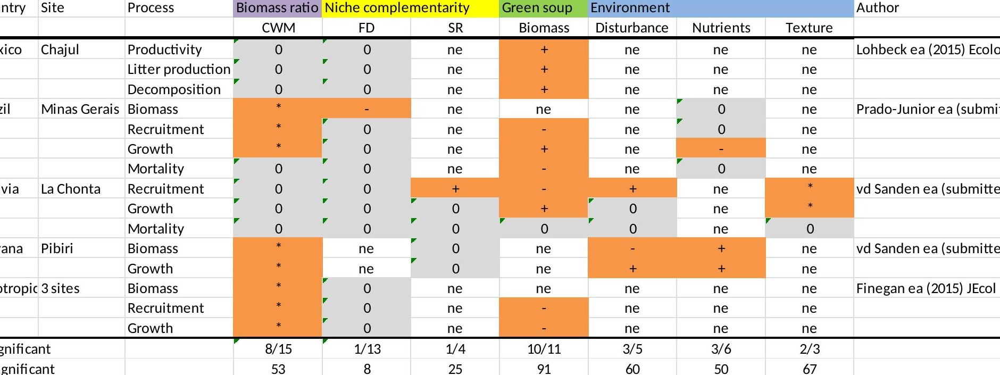{fig-align="center" width="90%"}

*Sítios: México, Brasil, Bolívia, Guiana e Neotrópicos.*

## O que explica melhor o funcionamento do ecossistema?

:::: {.columns}
::: {.column width="45%"}
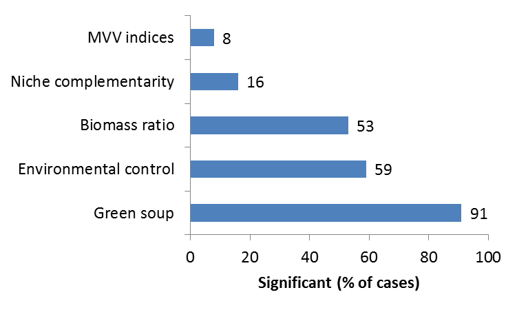{fig-align="center"}

*Significância (% dos casos): sopa verde 91; controle ambiental 59; razão de biomassa 53; complementaridade de nicho 16; índices de VMV 8.*
:::
::: {.column width="55%"}
- A MPC é estimada com mais acurácia que a DF. Talvez seja lógico que seja um preditor melhor?
- Avaliamos a produtividade de biomassa → talvez seja lógico que a biomassa (sopa verde) e a razão de biomassa sejam as mais importantes
- Talvez, para outros processos ecossistêmicos (polinização? estabilidade?), a complementaridade de nicho seja importante?
:::
::::

# 4. BFE: dominância

## Qual é o papel da dominância das espécies no funcionamento do ecossistema?

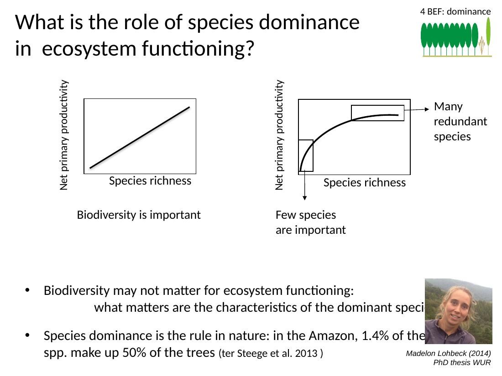{fig-align="center" width="70%"}

- **A biodiversidade é importante:** relação linear entre riqueza de espécies e produtividade primária líquida (PPL)
- **Poucas espécies são importantes:** muitas espécies redundantes
- A biodiversidade pode não importar para o funcionamento do ecossistema: o que importa são as características das espécies dominantes
- A dominância das espécies é a regra na natureza: na Amazônia, 1,4% das espécies compõem 50% das árvores (ter Steege et al. 2013)

::: ref
Madelon Lohbeck (2014) tese de doutorado, WUR
:::

## Contribuição das espécies para a produtividade

:::: {.columns}
::: {.column width="50%"}
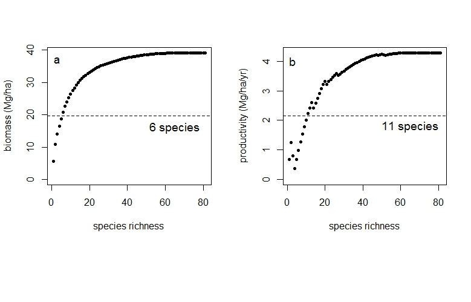{fig-align="center"}

*Biomassa (Mg/ha) e produtividade (Mg/ha/ano) acumuladas × riqueza de espécies. Linha tracejada: 50%; 6 espécies (biomassa) e 11 espécies (produtividade).*
:::
::: {.column width="50%"}
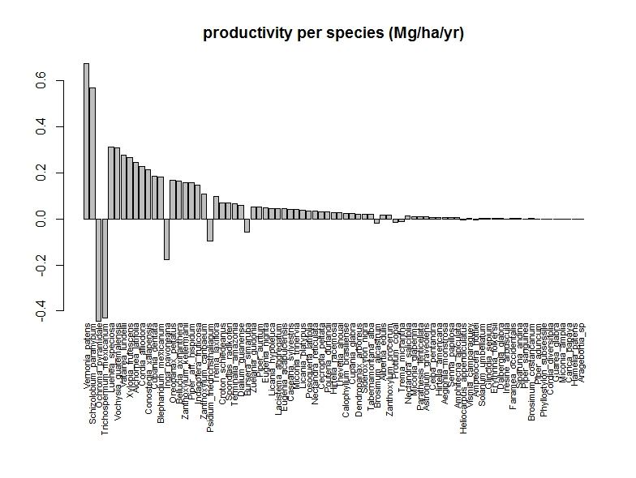{fig-align="center"}

*Produtividade por espécie (Mg/ha/ano).*
:::
::::

Poucas espécies contribuem muito; muitas contribuem pouco ou nada.

::: ref
Madelon Lohbeck (2014) tese de doutorado, WUR
:::

## E quanto a outros processos ecossistêmicos?

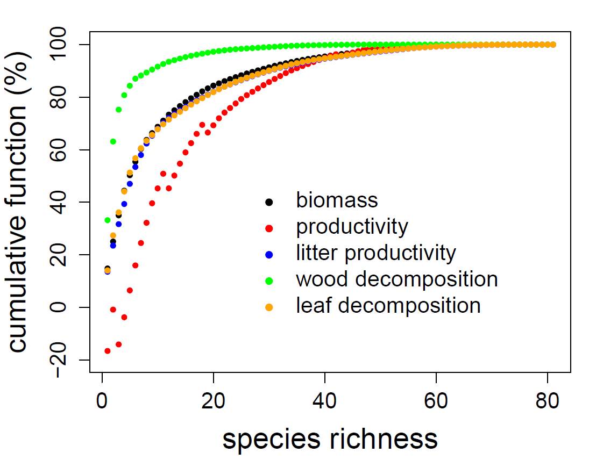{fig-align="center" width="50%"}

*Função acumulada (%) × riqueza de espécies, para biomassa, produtividade, produtividade de serapilheira, decomposição da madeira e decomposição das folhas. Espécies "importantes" (poucas, à esquerda, com um "?") e espécies "sem importância" (maioria, à direita).*

## Quais são as espécies importantes?

| | Estoques de biomassa | Produção de biomassa | Produção de serapilheira | Decomposição da madeira | Decomposição das folhas |
|---|---|---|---|---|---|
| Espécie 1 | Trichospermum | Vernonia | Trichospermum | Trichospermum | Schizolobium |
| Espécie 2 | Schizolobium | Schizolobium | Schizolobium | Ochroma | Trichospermum |
| Espécie 3 | Cordia | Luehea | Luehea | Schizolobium | Vernonia |
| Espécie 4 | Luehea | Vochysia | Cordia | Inga | Cordia |
| Nº de espécies para 50% da função | 6 | 11 | 6 | 2 | 5 |

**As dominantes!**

::: ref
Madelon Lohbeck (2014) tese de doutorado, WUR
:::

## O que determina a forma da curva BFE?

Dois experimentos de simulação

:::: {.columns}
::: {.column width="50%"}
**1. Manter a dominância, aleatorizar a produtividade das espécies**

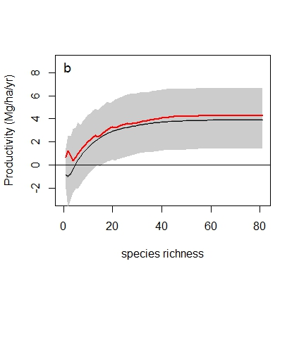{fig-align="center"}

- A forma da curva permanece a mesma ao aleatorizar a identidade das espécies
- → A forma da curva se deve à estrutura de dominância
- A variação em torno da curva se deve à identidade das espécies
:::
::: {.column width="50%"}
**2. Dominância igual, aleatorizar a produtividade das espécies**

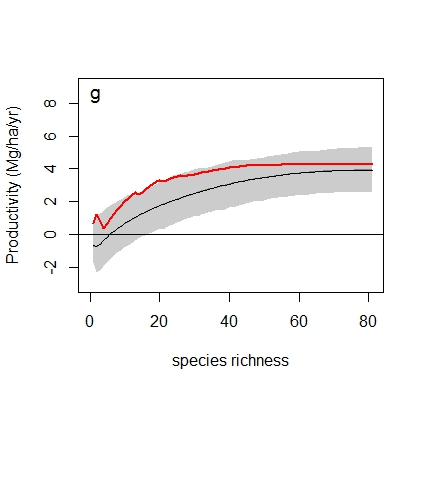{fig-align="center"}

- A forma da curva fica mais linear ao igualar as abundâncias das espécies
- → A biodiversidade se torna mais importante com o aumento da equabilidade da abundância
:::
::::

*Eixos: riqueza acumulada de espécies × produtividade acumulada; observado × simulado.*

::: ref
Madelon Lohbeck (2014) tese de doutorado, WUR
:::

::: {.notes}
A linha vermelha é a situação real, a mesma curva mostrada anteriormente na figura do slide 20.
:::

## Quão universal é isso?

As espécies dominantes determinam o funcionamento do ecossistema?

:::: {.columns}
::: {.column width="50%"}
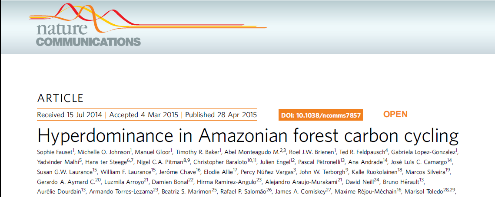{fig-align="center"}

**1% das espécies de árvores respondem por 50% do armazenamento e do sequestro de carbono na Amazônia!!**
:::
::: {.column width="50%"}
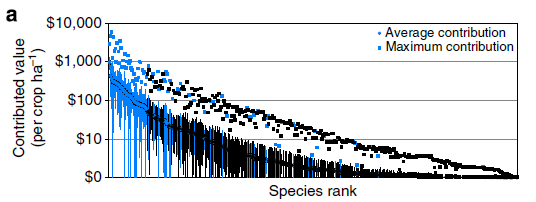{fig-align="center"}

**2% das espécies de abelhas respondem por 80% das visitas a flores de cultivos!**
:::
::::

## Ampliando a escala no espaço e no tempo: modelos dinâmicos globais de vegetação (MDGV)!

:::: {.columns}
::: {.column width="55%"}
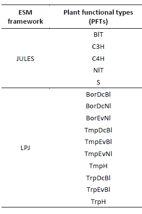{fig-align="center" width="35%"}

Tipos funcionais de plantas do modelo; grupos: gramínea C3, gramínea C4, arbusto, árvore decídua, árvore conífera.
:::
::: {.column width="45%"}
**Quanta da diversidade global de espécies está incluída nesses modelos?**

330.000 espécies → **5!??** grupos funcionais
:::
::::

::: {.notes}
Paul Fine: 45.000 espécies de árvores no mundo, 96% (>43.200) nos trópicos.
:::

## Papel limitado para a biodiversidade? E o efeito seguro (*insurance effect*)?

:::: {.columns}
::: {.column width="55%"}
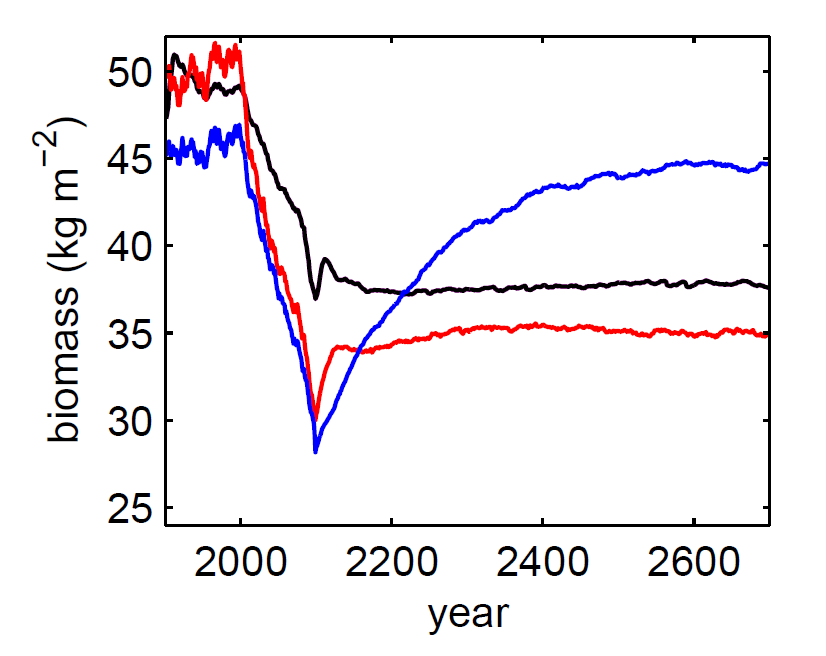{fig-align="center"}
:::
::: {.column width="45%"}
- MDGV de atributos, nº infinito de grupos funcionais (contínuo)
- MDGV normal, 2 grupos funcionais
- MDGV de atributos, 2 grupos funcionais

**A alta biodiversidade torna a floresta mais resiliente a secas futuras!**

Substituição de espécies úmidas por espécies mais tolerantes à seca
:::
::::

*Eixos: tempo (anos) × biomassa (kg m⁻²).*

::: ref
Sakschewski, Boit, Thonicke, Peña-Claros, Poorter et al. (em prep.)
:::

## Biodiversidade e Funcionamento do Ecossistema: resumo

- **Diversidade taxonômica:** a riqueza de espécies importa para a BAS em florestas hiperdiversas
- **Diversidade funcional:** produtividade e estoques são determinados por atributos da MPC
- **Mecanismos:** a biomassa é um fator mais importante para o PE do que a diversidade
- **Dominância:** poucas espécies contribuem para o PE → a biodiversidade importa especialmente em comunidades com abundâncias equilibradas

## O que determina a dinâmica da biomassa no Escudo das Guianas?

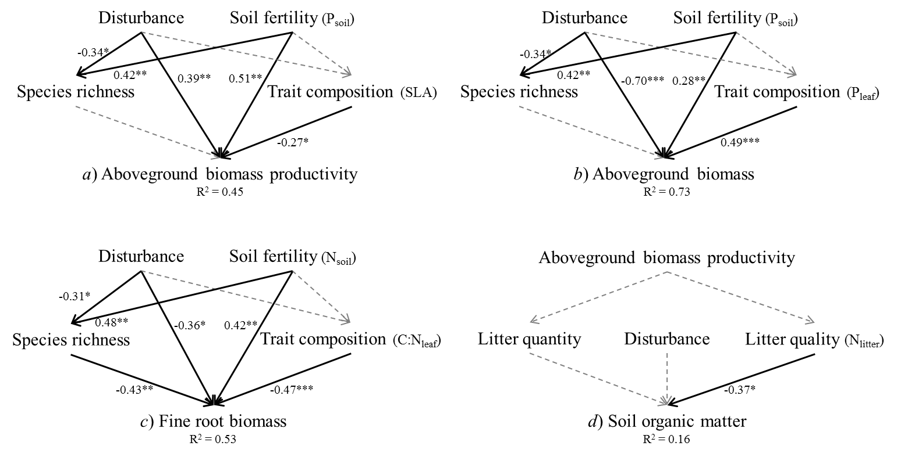{fig-align="center" width="85%"}

::: ref
Masha van der Sande et al. (submetido)
:::
