## Uma pergunta central

::: {.r-fit-text}
**O que, na biodiversidade de uma floresta tropical, controla seu funcionamento?**
:::

- o **número** de espécies (riqueza)?
- a **variedade** de atributos funcionais (diversidade funcional)?
- os atributos das espécies **dominantes** (razão de massa)?
- simplesmente a **quantidade** de vegetação (biomassa)?

## Roteiro

1. **Conceitos:** atributos funcionais, biodiversidade funcional e as três hipóteses
2. **Teoria da razão de massa** e como medi-la (MPC)
3. **Evidências em florestas tropicais:** sucessão, florestas maduras, florestas secas
4. **Dominância:** por que poucas espécies fazem quase tudo
5. **Síntese:** o que sabemos e o que falta

# 1. Conceitos

## Por que atributos funcionais?

:::: {.columns}
::: {.column width="50%"}
O número de espécies diz pouco sobre **o que as espécies fazem**.

Os **atributos funcionais** são características (morfológicas, fisiológicas, fenológicas) que influenciam o desempenho individual e, somados, o funcionamento do ecossistema.

- **Atributos de resposta:** como a espécie reage ao ambiente (luz, seca, perturbação)
- **Atributos de efeito:** como a espécie afeta processos (produtividade, decomposição, estoque de carbono)
:::
::: {.column width="50%"}
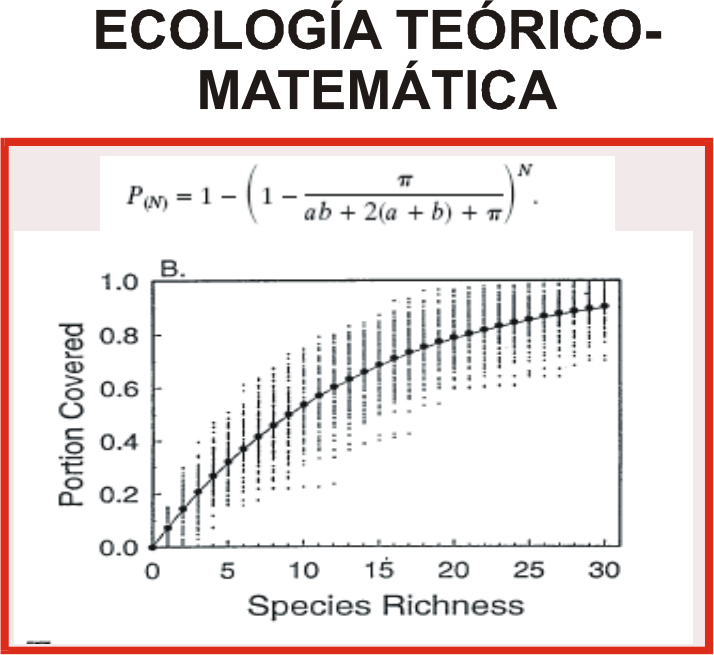{fig-align="center" width="70%"}

*Nem todas as espécies são iguais, nem igualmente abundantes.*
:::
::::

::: take
**O que importa não é só quantas espécies existem, mas quais atributos elas têm e quanto pesam na comunidade.**
:::

::: ref
Slide: S. Díaz · Díaz et al. (2007) PNAS
:::

## Biodiversidade funcional: três componentes

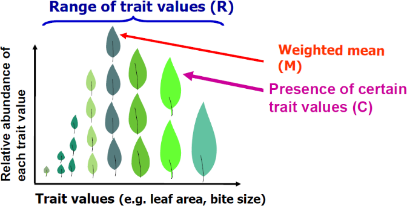{fig-align="center" width="62%"}

| Componente | Pergunta | Métrica típica |
|---|---|---|
| **Valor / média** | Qual é o atributo típico (dominante)? | Média ponderada da comunidade (MPC) |
| **Amplitude / variedade** | Quão diferentes são as espécies? | Riqueza, equabilidade, divergência funcional (DF) |
| **Presença** | Existe um atributo particular? | Presença de um tipo funcional ou espécie-chave |

::: ref
Slide: S. Díaz · Díaz et al. (2007) PNAS
:::

## Três hipóteses rivais para o funcionamento do ecossistema

```{mermaid}
flowchart LR
  B["Biomassa<br/>(quantidade de vegetação)"]
  M["Média ponderada<br/>dos atributos (MPC)"]
  D["Diversidade funcional<br/>(variedade de atributos)"]
  F(("Função do<br/>ecossistema"))
  B -->|"Sopa verde"| F
  M -->|"Razão de massa"| F
  D -->|"Complementaridade<br/>de nicho"| F
```

| Hipótese | Mecanismo | Predição | Métrica |
|---|---|---|---|
| **Sopa verde** | Mais vegetação, mais processo | Função cresce com a biomassa | Biomassa inicial |
| **Razão de massa** | Os atributos das espécies **dominantes** determinam o processo | Função segue o valor médio do atributo | MPC |
| **Complementaridade de nicho** | Espécies diferentes usam recursos diferentes | Função cresce com a variedade de atributos | Riqueza, equabilidade e divergência funcional |

::: ref
Garnier et al. (2004) Ecology · Lohbeck et al. (2015) Ecology · Finegan et al. (2015) J. Ecol.
:::

# 2. Teoria da razão de massa

## A hipótese da razão de massa (*mass ratio*)

Em Grime (1998), as espécies de uma comunidade se dividem em:

- **Dominantes:** grandes, respondem pela maior parte da biomassa
- **Subordinadas:** menores, vivem em microhabitats criados pelas dominantes
- **Transientes:** pouco abundantes e de vida curta (muitas vezes juvenis de espécies vizinhas)

::: take
**Ideia central:** o controle imediato dos processos ecossistêmicos depende, em grande parte, dos **atributos das espécies dominantes** (a contribuição de cada espécie é proporcional à sua fração da biomassa), e pouco da riqueza de espécies subordinadas e transientes.
:::

Subordinadas e transientes importam de forma intermitente, por exemplo ao regenerar as dominantes depois de grandes perturbações.

::: ref
Grime (1998) Journal of Ecology 86: 902–910 · Garnier et al. (2004) Ecology 85: 2630–2637
:::

## Como medir: a média ponderada da comunidade (MPC)

Para a parcela $j$, com $p_{ij}$ a abundância relativa da espécie $i$ e $t_i$ o valor do atributo:

$$\mathrm{MPC}_j = \sum_{i=1}^{S} p_{ij}\, t_i$$

- Dados necessários: matriz **parcelas × espécies** ($p_{ij}$) e matriz **espécies × atributos** ($t_i$)
- A ponderação importa: **área basal (ou cobertura)** acompanha de perto a biomassa e a área foliar total, e tende a se relacionar mais fortemente com o PE do que a abundância ou a presença/ausência
- Presença/ausência dá peso excessivo a espécies acidentais

```{r}
#| eval: false
library(FD)

# traits: espécies x atributos (AFE, TNF, densidade da madeira, Hmax...)
# abund : parcelas x espécies (área basal)
mpc <- functcomp(x = traits, a = abund)   # MPC por parcela

fd  <- dbFD(x = traits, a = abund)        # riqueza, equabilidade, divergência
```

## Dos atributos das espécies aos atributos da comunidade

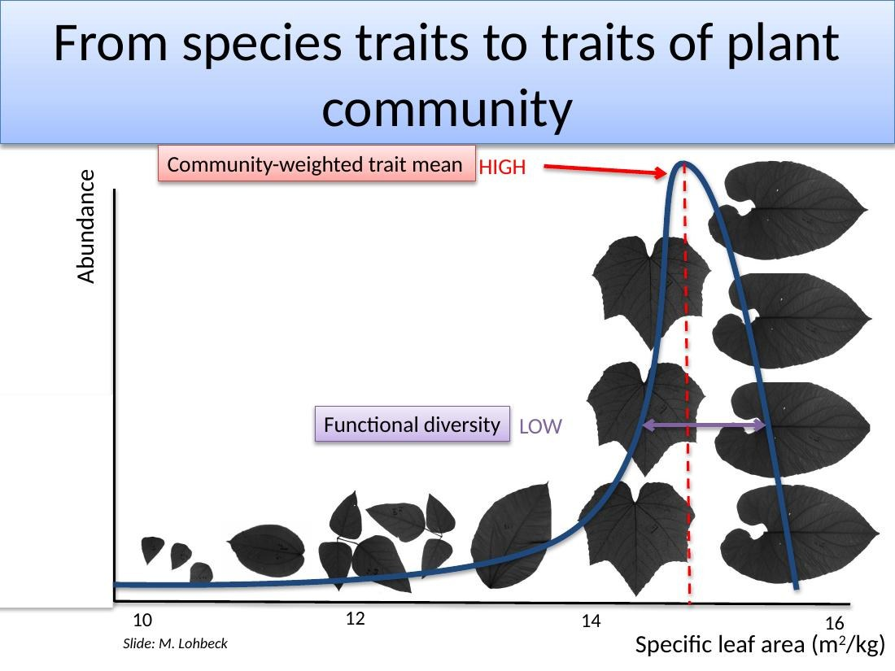{fig-align="center" width="62%"}

*Mesma MPC pode vir com diversidade funcional baixa ou alta: MPC e DF descrevem coisas diferentes.*

::: ref
Slide: M. Lohbeck
:::

## Quais atributos medir? Depende da pergunta

| Atributo | Responde a | Efeito sobre o funcionamento |
|---|---|---|
| Área foliar específica (AFE), teor de N e P foliar | Luz, calor | Produtividade, decomposição |
| Teor de matéria seca, espessura e dureza foliar | Sombra, herbivoria | Estoque de carbono, serapilheira |
| Densidade da madeira | Sombra, seca | Estoque de carbono |
| Altura máxima (Hmax) | Luz | Biomassa e estoque de carbono |
| Volume da semente, dispersão biótica | Sombra, conectividade | Fonte de alimento |
| Deciduidade, composição foliar | Seca, calor | Serapilheira, produtividade |

::: take
Nas florestas tropicais, a maior parte da variação se organiza em um eixo **rápido ↔ lento** (aquisitivo ↔ conservativo).
:::

::: ref
Díaz et al. (2007) PNAS · Finegan et al. (2015) J. Ecol.
:::

## Ressalvas sobre os índices de diversidade funcional

- Os processos são determinados por **todos** os atributos? → o índice de DF resume bem
- Por um **subconjunto** ou por **um só** atributo? → o índice de DF esconde o padrão
- Alternativa simples: descrever cada atributo por **MPC, coeficiente de variação (CV) e curtose (K)**

**VMV: Vago MultiVariado: você não sabe o que está olhando!**

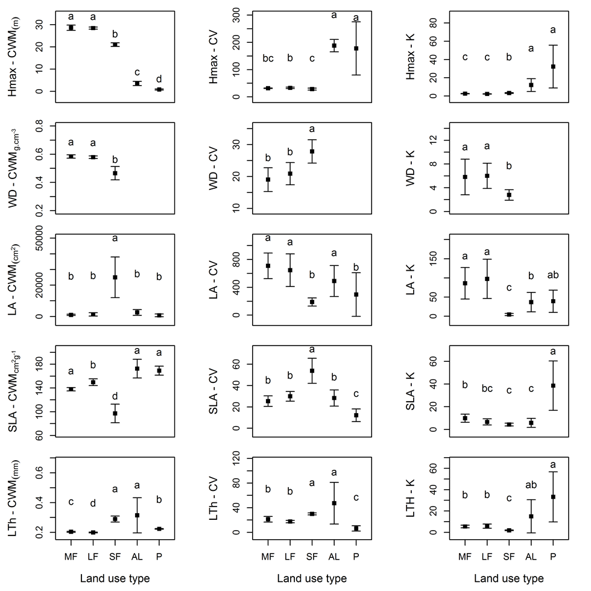{fig-align="center" width="60%"}

::: ref
Carreño-Rocabado et al. (2015) Ecological Applications
:::

# 3. Evidências nas florestas tropicais

## Sucessão secundária (México): a biomassa manda

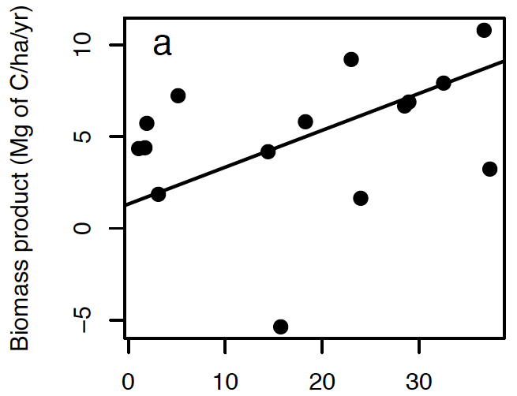{fig-align="right" width="30%"}

Cronosequência após agricultura itinerante em floresta úmida; processos: produtividade de biomassa, de serapilheira e decomposição. Modelagem de equações estruturais (MEE) com as três hipóteses.

- A **biomassa** foi o principal fator de **todos** os processos estudados
- A **MPC da AFE** afetou positivamente a produtividade de biomassa; a **MPC da matéria seca foliar** afetou negativamente a decomposição potencial
- A **divergência funcional** afetou positivamente a decomposição potencial
- Diversidade funcional e MPC tiveram papel **secundário**: o forte acúmulo de biomassa ofusca efeitos mais sutis

::: take
**Quantidade de vegetação > qualidade da vegetação** (sopa verde).
:::

::: ref
Lohbeck, Poorter, Martínez-Ramos, Bongers (2015) Ecology 96: 1242–1252
:::

## Florestas maduras (Bolívia, Brasil, Costa Rica): razão de massa

:::: {.columns}
::: {.column width="50%"}
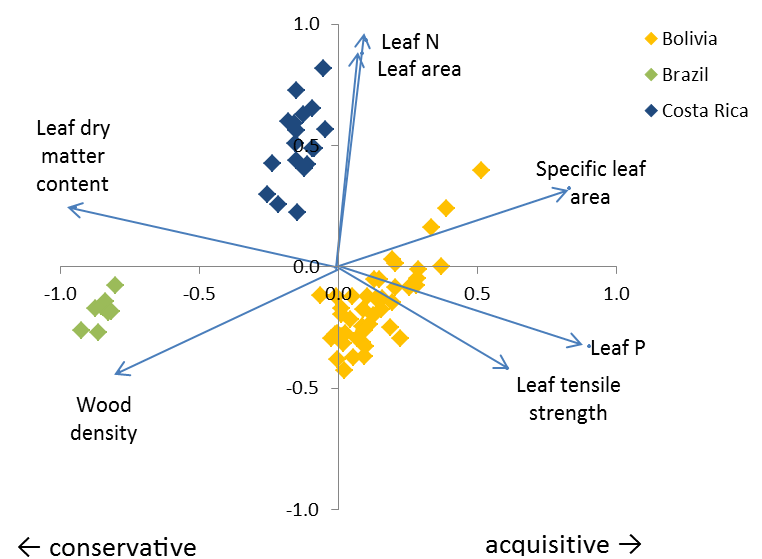{fig-align="center"}

*Eixo conservativo ↔ aquisitivo separa os sítios.*
:::
::: {.column width="50%"}
Três hipóteses testadas com biomassa aérea inicial (BAS) e incrementos de biomassa (árvores ≥ 10 cm de DAP), com a MPC de 8 atributos e quatro índices de DF.

- **Razão de massa: forte suporte.** A MPC da **altura máxima (Hmax)** foi o melhor preditor da BAS; atributos foliares, sobretudo a **AFE**, predisseram os incrementos
- **Complementaridade de nicho: sem suporte** (DF sem relação com os incrementos)
- **Sopa verde:** apoiada só para o incremento dos recrutas
- Povoamentos "rápidos" (AFE e TNF altos): crescimento rápido, mas rotatividade rápida e menor estoque
:::
::::

::: ref
Finegan, Peña-Claros, Oliveira, ... Poorter (2015) Journal of Ecology
:::

## Florestas secas (Brasil): espécies conservativas dominam

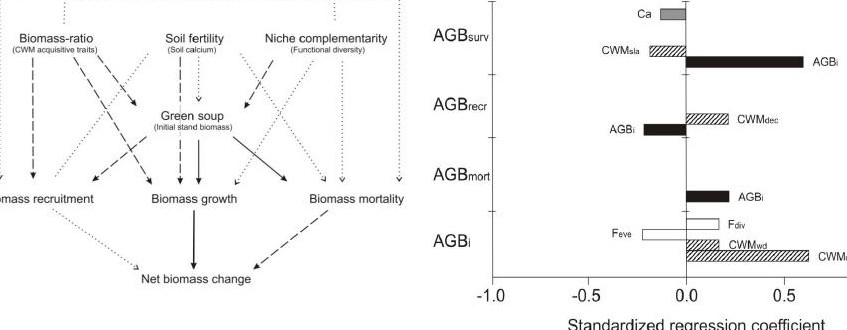{fig-align="center" width="55%"}

200 parcelas permanentes em 8 florestas secas, monitoradas por 5 anos.

- A **biomassa inicial** foi o melhor preditor de crescimento, mortalidade e recrutamento (sopa verde)
- Povoamentos de espécies **conservativas** (AFE baixa, densidade da madeira alta) tiveram **mais** crescimento e estoque: "lentos" nos atributos, "rápidos" na produtividade, ao contrário das florestas úmidas
- **Sem suporte** à complementaridade de nicho: **menor** diversidade funcional se associou a mais biomassa

::: ref
Prado-Junior, Schiavini, Vale, van der Sande, Lohbeck, Poorter (2016) Journal of Ecology 104: 817–827
:::

## Escala neotropical: diversidade, atributos e clima

:::: {.columns}
::: {.column width="55%"}
**26 sítios, 201 parcelas de 1 ha, > 92.000 árvores** (Poorter et al. 2017):

- Atributos da vegetação (riqueza, MPC, área basal) se relacionaram com biomassa e dinâmica mais vezes que o ambiente (67% vs. 33% das relações)
- **Disponibilidade de água:** o fator ambiental mais forte (crescimento e estoque)
- **Riqueza rarefeita:** relação positiva com estoques e dinâmica, mas **não** com a produtividade líquida
- **MPC:** bons preditores de estoques e dinâmica

**Poorter et al. (2015):** 59 sítios, ~2.050 parcelas, ~144.000 árvores: a riqueza de árvores tem efeito positivo e independente sobre a BAS, interpretado como uso complementar de recursos.
:::
::: {.column width="45%"}
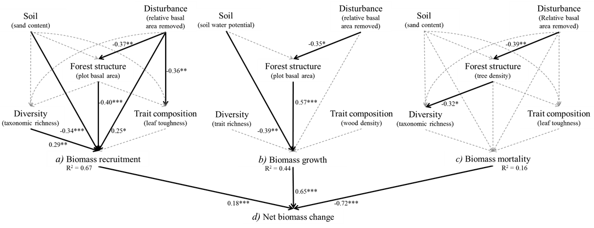{fig-align="center"}

*MEE de van der Sande et al. (dos slides originais): recrutamento, crescimento e mortalidade.*
:::
::::

::: ref
Poorter et al. (2015) Global Ecol. Biogeogr. · Poorter et al. (2017) Global Ecol. Biogeogr. 26: 1423–1434 · van der Sande et al. (slides originais)
:::

## Placar das hipóteses em florestas tropicais

| Estudo | Sítio | Sopa verde | Razão de massa (MPC) | Complementaridade (DF / riqueza) |
|---|---|---|---|---|
| Lohbeck et al. (2015) | Sucessão, México | **Principal fator** | Secundária (AFE, MSF) | Secundária (divergência) |
| Finegan et al. (2015) | Maduras, 3 países | Só recrutas | **Forte (Hmax, AFE)** | Sem suporte (DF) |
| Prado-Junior et al. (2016) | Secas, Brasil | **Forte** | Conservativas dominam | Sem suporte |
| Poorter et al. (2015, 2017) | Neotrópico | — | MPC bons preditores | **Riqueza**: efeito positivo em estoques |

::: take
Em geral: **biomassa e razão de massa** explicam mais que a **diversidade funcional**; a **riqueza** pode contribuir para o estoque de carbono, mas o mecanismo ainda é debatido.
:::

*Ressalva: a MPC é estimada com mais acurácia que a DF, e foi avaliada sobretudo a produtividade de biomassa. Para outros processos (polinização, estabilidade), a complementaridade pode importar mais.*

# 4. Dominância

## Por que a razão de massa funciona nos trópicos?

:::: {.columns}
::: {.column width="50%"}
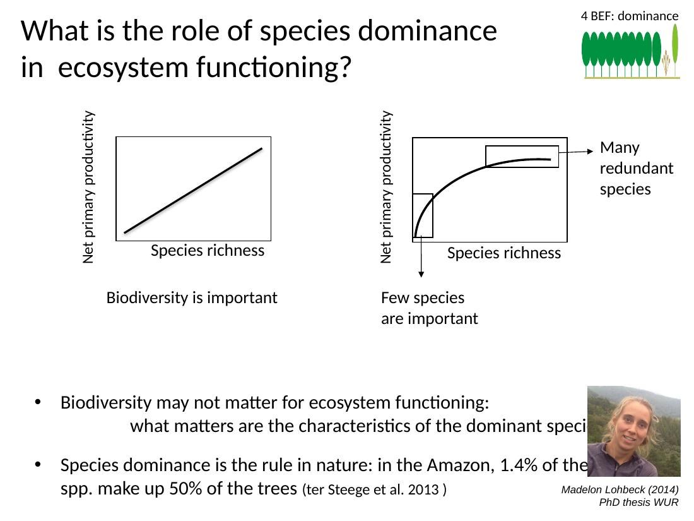{fig-align="center"}
:::
::: {.column width="50%"}
- **A dominância é a regra:** na Amazônia, ~1,4% das espécies compõem 50% das árvores (ter Steege et al. 2013)
- Poucas espécies concentram a biomassa e a produtividade; muitas são "redundantes" para o processo
- Se poucas espécies dominam, a **MPC** acompanha os atributos dessas poucas
:::
::::

::: ref
ter Steege et al. (2013) Science · Lohbeck (2014) tese de doutorado, WUR
:::

## Poucas espécies, muita função

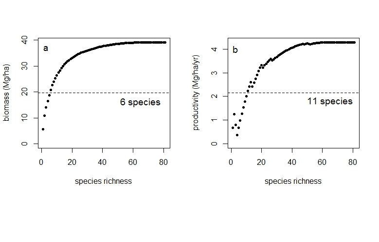{fig-align="center" width="42%"}

*Em uma floresta secundária: 6 espécies fazem 50% da biomassa; 11 espécies, 50% da produtividade.*

| | Biomassa | Produção | Serapilheira | Decomposição (madeira) | Decomposição (folhas) |
|---|---|---|---|---|---|
| Nº de espécies para 50% da função | 6 | 11 | 6 | 2 | 5 |

::: ref
Madelon Lohbeck (2014) tese de doutorado, WUR
:::

## O que molda a curva biodiversidade–função?

:::: {.columns}
::: {.column width="50%"}
**1. Mantém a dominância, aleatoriza a identidade**

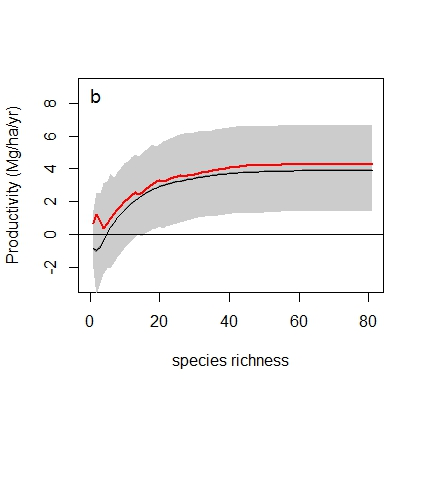{fig-align="center" width="85%"}

A forma da curva **não muda** → vem da estrutura de dominância.
:::
::: {.column width="50%"}
**2. Dominância igual, aleatoriza a identidade**

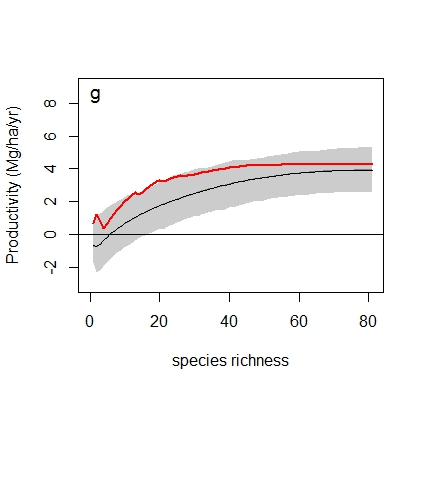{fig-align="center" width="85%"}

A curva fica **mais linear** → a biodiversidade importa mais quando as abundâncias são equilibradas.
:::
::::

::: ref
Madelon Lohbeck (2014) tese de doutorado, WUR
:::

## Quão universal é isso?

:::: {.columns}
::: {.column width="50%"}
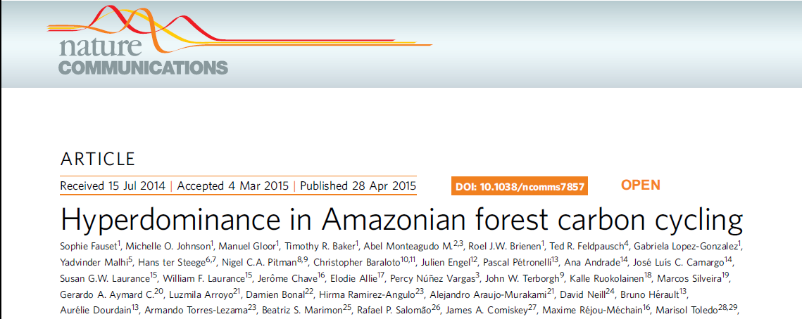{fig-align="center"}

**1% das espécies de árvores** respondem por 50% do armazenamento e do sequestro de carbono na Amazônia.
:::
::: {.column width="50%"}
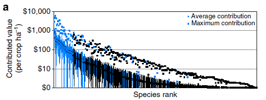{fig-align="center"}

**2% das espécies de abelhas** respondem por 80% das visitas a flores de cultivos.
:::
::::

## Do conjunto de dados ao modelo: o efeito seguro (*insurance*)

:::: {.columns}
::: {.column width="55%"}
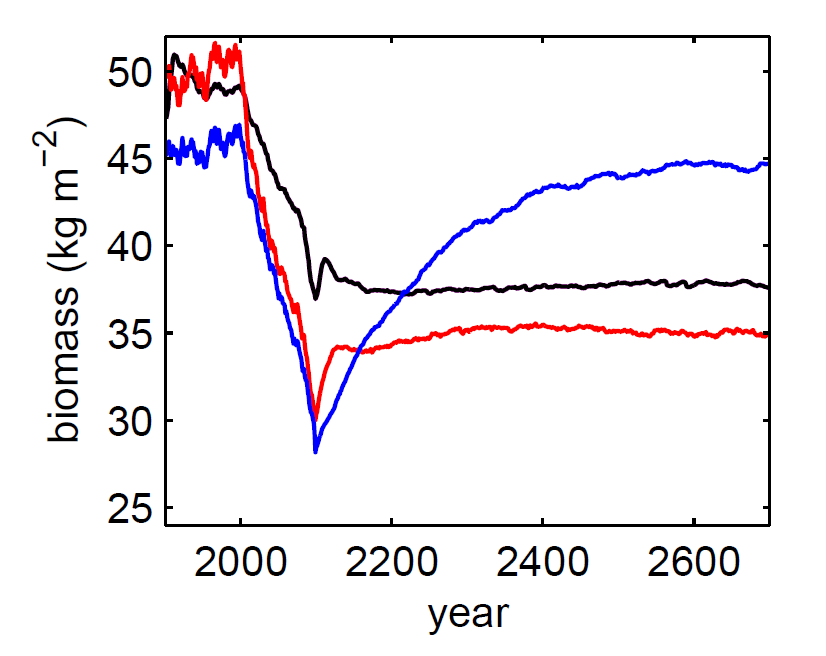{fig-align="center"}
:::
::: {.column width="45%"}
Os modelos dinâmicos globais de vegetação (MDGV) usam **~5 tipos funcionais** para centenas de milhares de espécies.

Simulações que permitem **diversidade contínua de atributos** mostram que a diversidade funcional pode ajudar a floresta amazônica a **se ajustar a novas condições climáticas** (substituição de espécies úmidas por mais tolerantes à seca).

::: take
A razão de massa explica o **presente**; a diversidade pode importar para a **resiliência futura**.
:::
:::
::::

::: ref
Sakschewski et al. (2016) Nature Climate Change 6: 1032–1036
:::

# 5. Síntese

## Como estudar: abordagem em cinco etapas

1. Defina o **processo (PE)** e o **serviço ecossistêmico (SE)** de interesse
2. Defina os **atributos de efeito** relevantes (exige compreensão mecanística)
3. **Meça** os atributos: por indivíduo? por espécie? Um indivíduo por espécie por parcela é razoável; o banco de dados descreve bem a MPC, mas mal a variação
4. **Calcule** a MPC (ponderar por área basal) e a DF (com CV e K como alternativas)
5. **Relacione** à função com MEE, **separando biomassa, MPC e DF**

::: ref
Díaz et al. (2007) PNAS · Baraloto et al. (2010) Functional Ecology
:::

## Mensagens-chave

- **Razão de massa:** nas florestas tropicais, os atributos das espécies **dominantes** (MPC) explicam produtividade e estoque melhor que a variedade de atributos
- **Biomassa primeiro:** a quantidade de vegetação costuma ofuscar efeitos da qualidade; **modele-a explicitamente**
- **Rápido ou lento depende do bioma:** em florestas úmidas, AFE alta → mais crescimento; em florestas secas, espécies conservativas sustentam a produtividade
- **Riqueza e carbono:** há efeito positivo da riqueza no estoque em escala neotropical, ainda sem mecanismo fechado
- **Biodiversidade importa:** para outros serviços (polinização, estabilidade) e para a resiliência a secas futuras

## Lacunas e próximos passos

- Testar **outros processos** além da produtividade de biomassa (decomposição, estabilidade, polinização)
- Medir a **variação intraespecífica** dos atributos, e não só médias de espécies
- Comparar métricas de DF **univariadas** com índices multivariados
- Integrar **diversidade e dominância** em modelos de vegetação

## Referências {.smaller}

- Baraloto et al. (2010) Functional trait variation and sampling strategies in species-rich plant communities. *Functional Ecology* 24: 208–216.
- Carreño-Rocabado et al. (2015) *Ecological Applications*.
- Díaz, Lavorel, de Bello, Quétier, Grigulis, Robson (2007) Incorporating plant functional diversity effects in ecosystem service assessments. *PNAS*.
- Finegan, Peña-Claros, Oliveira, ..., Poorter (2015) Does functional trait diversity predict aboveground biomass and productivity of tropical forests? Testing three alternative hypotheses. *Journal of Ecology*.
- Garnier et al. (2004) Plant functional markers capture ecosystem properties during secondary succession. *Ecology* 85: 2630–2637.
- Grime (1998) Benefits of plant diversity to ecosystems: immediate, filter and founder effects. *Journal of Ecology* 86: 902–910.
- Lohbeck, Poorter, Martínez-Ramos, Bongers (2015) Biomass is the main driver of changes in ecosystem process rates during tropical forest succession. *Ecology* 96: 1242–1252.
- Poorter et al. (2015) Diversity enhances carbon storage in tropical forests. *Global Ecology and Biogeography*.
- Poorter et al. (2017) Biodiversity and climate determine the functioning of Neotropical forests. *Global Ecology and Biogeography* 26: 1423–1434.
- Prado-Junior, Schiavini, Vale, van der Sande, Lohbeck, Poorter (2016) Conservative species drive biomass productivity in tropical dry forests. *Journal of Ecology* 104: 817–827.
- Sakschewski et al. (2016) Resilience of Amazon forests emerges from plant trait diversity. *Nature Climate Change* 6: 1032–1036.
- ter Steege et al. (2013) Hyperdominance in the Amazonian tree flora. *Science*.
- van der Sande et al. (2017) Abiotic and biotic drivers of biomass change in a Neotropical forest. *(conferir se é a versão publicada do trabalho "submetido" nos slides originais)*
